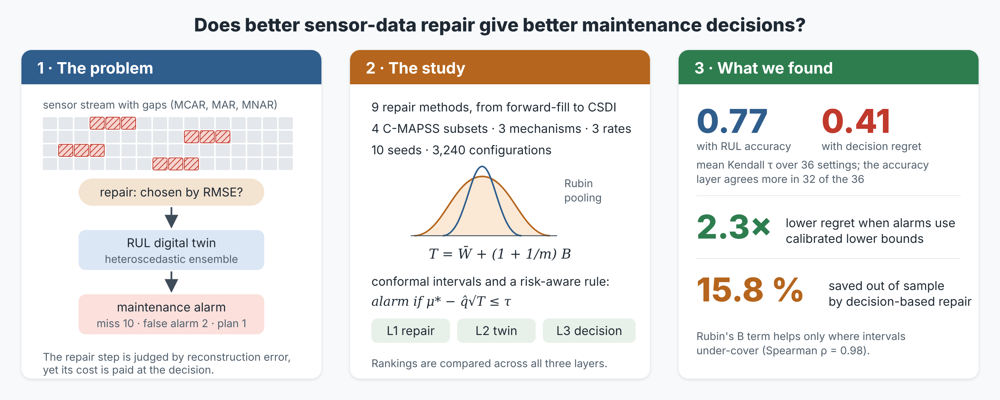
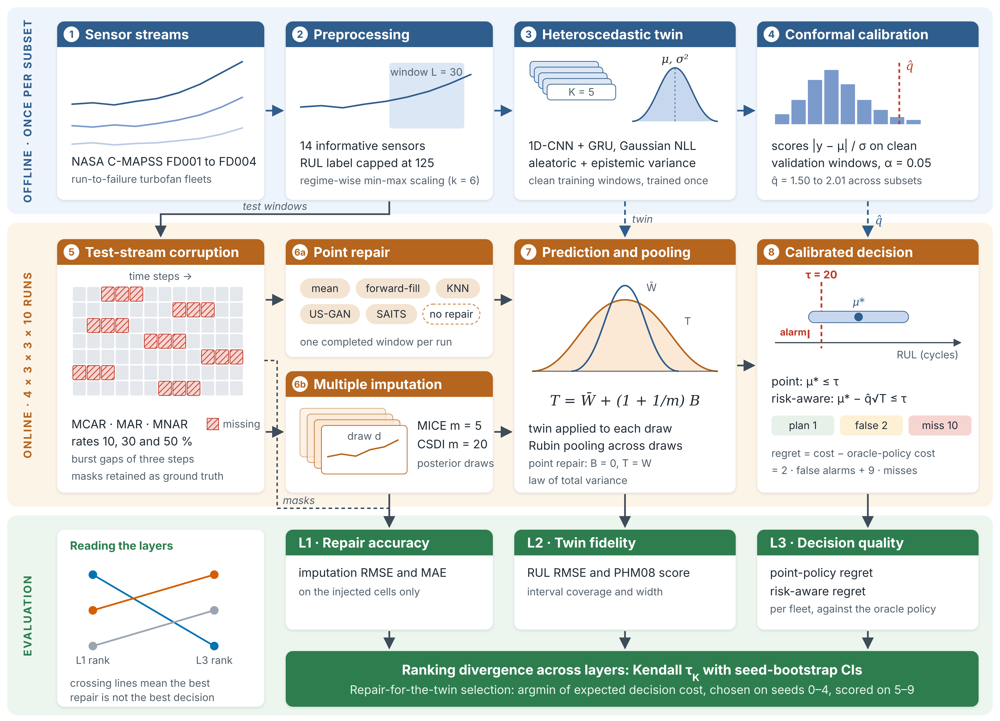

<div align="center">

# Repair for the Twin

**Decision-aware evaluation of sensor-data imputation for digital-twin prognostics with uncertainty propagation**

[](https://github.com/gulzara3/repair-for-the-twin/actions/workflows/ci.yml)
[](pyproject.toml)
[](LICENSE)
[](data/README.md)



</div>

## Overview

Digital twins for prognostics receive sensor streams with gaps, and a repair step fills them before the twin predicts remaining useful life (RUL). The repair method is usually chosen by its reconstruction error. This repository tests whether that choice carries through to **maintenance decisions**.

We corrupt the inference streams of all four NASA C-MAPSS subsets under MCAR, MAR and MNAR missingness, repair them with nine methods, and pass the result through a heteroscedastic deep-ensemble twin. Multiple imputations are pooled with Rubin's rules, intervals are calibrated by split-conformal scaling, and an alarm policy turns predictions into maintenance actions with an asymmetric cost model.

<p align="center">
  
</p>

## Key results

All numbers below are recomputed from [`results/all_results.csv`](results/all_results.csv) by `repair4twin summary`, and are checked in CI by [`tests/test_paper_numbers.py`](tests/test_paper_numbers.py).

| Finding | Result |
|---|---|
| Mean Kendall τ between imputation-RMSE ranks and RUL-RMSE ranks | **0.77** |
| Mean Kendall τ between imputation-RMSE ranks and decision-regret ranks | **0.41** |
| Settings where reconstruction error agrees more with accuracy than with decisions | **32 of 36** (one-sided Wilcoxon, p = 3.9 × 10⁻⁷) |
| Regret of the point alarm rule divided by regret of the risk-aware rule | median **2.27** (IQR 1.59 to 2.70) |
| Rubin's B term versus coverage reached without it | Spearman **0.98** over 8 subset means, 0.46 over 72 cells |
| Out-of-sample saving from choosing repair by decision cost | **4.9 %** (FD001), **15.8 %** (FD003), 0 on FD002 and FD004 |

The risk-aware rule raises an alarm when the conformal lower bound $\mu^\ast - \hat q\sqrt{T}$ falls to the threshold τ = 20 cycles, where $T = \bar W + (1 + 1/m)B$ is Rubin's total variance.

## Repository layout

```text
repair-for-the-twin/
├── src/repair4twin/          Python package
│   ├── config.py             all experiment settings (paper defaults, quick mode)
│   ├── data.py               C-MAPSS download, scaling, windowing
│   ├── corruption.py         MCAR / MAR / MNAR burst-gap injection
│   ├── imputers.py           nine repair methods (scikit-learn, PyPOTS)
│   ├── twin.py               heteroscedastic CNN-GRU twin, deep ensemble, conformal q
│   ├── uncertainty.py        Rubin's rules, conformal quantile, interval metrics
│   ├── metrics.py            RMSE, PHM08, maintenance cost and decision regret
│   ├── harness.py            resumable corrupt → repair → predict → decide loop
│   ├── store.py              checkpoints and de-duplicated results
│   ├── stats.py              every statistic reported in the paper
│   └── cli.py                `repair4twin download | run | summary`
├── notebooks/                original Google Colab notebook (v2, used for the paper)
├── scripts/                  figure, table and diagram generators
├── results/                  released results: 3,240 configurations
├── figures/                  paper and supplementary figures (300 dpi) and diagram sources
├── tables/                   paper and supplementary tables (Markdown)
├── tests/                    unit tests and paper-number regression tests
└── docs/                     methodology, reproducibility and results schema
```

## Installation

```bash
git clone https://github.com/gulzara3/repair-for-the-twin.git
cd repair-for-the-twin
python -m venv .venv
source .venv/bin/activate          # Windows: .venv\Scripts\activate
pip install -e ".[figures,dev]"    # analysis of the released results (CPU)
pip install -e ".[all]"            # full experiment (adds PyTorch and PyPOTS)
```

## Reproducing the paper

There are three levels, from seconds to hours.

**1. Check the headline numbers (seconds, CPU).**

```bash
repair4twin summary
pytest
```

**2. Rebuild every CSV-derived figure and table (about a minute, CPU).**

```bash
python scripts/make_figures.py     # Figs. 2-4, 7, 8 and S1-S4
python scripts/make_tables.py      # Tables 3-8 and S2-S9
```

**3. Rerun the full experiment (GPU).**

```bash
repair4twin download               # NASA C-MAPSS into data/cmapss/
repair4twin run --quick            # smoke test on FD001, about 25 minutes
repair4twin run                    # all four subsets, about 8 to 12 GPU hours
```

Every trained model and every finished block is saved under `runs/`, so an interrupted run continues where it stopped. The [Colab notebook](notebooks/self_healing_digital_twins_v2.ipynb) runs the same pipeline with Google Drive checkpointing, and its Section 7 also draws Figs. 5, 6 and 9 from the saved prediction archives. See [`docs/reproducibility.md`](docs/reproducibility.md) for hardware, timings and seeds.

## Method at a glance

| Component | Setting |
|---|---|
| Data | C-MAPSS FD001 to FD004, 14 sensors, windows of 30 cycles, RUL capped at 125 |
| Corruption | MCAR, MAR, MNAR; rates 0.1, 0.3, 0.5; burst gaps of 3 cycles; 10 seeds |
| Repair | no repair, mean, forward-fill, KNN, MICE (m = 5), US-GAN, SAITS, CSDI (m = 20), clean input |
| Twin | 1D-CNN + GRU, Gaussian NLL head, deep ensemble of K = 5 |
| Uncertainty | Rubin's rules over imputation draws; split-conformal multiplier from clean validation data |
| Decision | alarm threshold τ = 20; costs planned 1, false alarm 2, missed failure 10 |

Details and equations are in [`docs/methodology.md`](docs/methodology.md).

## Citation

If you use this code or the results, please cite the paper (details will be updated on publication) and the software:

```bibtex
@article{repair4twin2026,
  title   = {Repair for the Twin: Decision-Aware Evaluation of Sensor-Data Imputation
             for Digital-Twin Prognostics with Uncertainty Propagation},
  author  = {Author One and Author Two and Author Three},
  journal = {Manuscript under review},
  year    = {2026}
}
```

GitHub also offers a ready citation from [`CITATION.cff`](CITATION.cff) through the "Cite this repository" button.

## License

Code is released under the [MIT License](LICENSE). The released results and figures are shared under [CC BY 4.0](https://creativecommons.org/licenses/by/4.0/). The C-MAPSS data belong to the NASA Prognostics Center of Excellence and are not redistributed here.

## Acknowledgements

This work builds on the NASA C-MAPSS simulation data, [PyPOTS](https://github.com/WenjieDu/PyPOTS) for the deep imputers, and [scikit-learn](https://scikit-learn.org).
